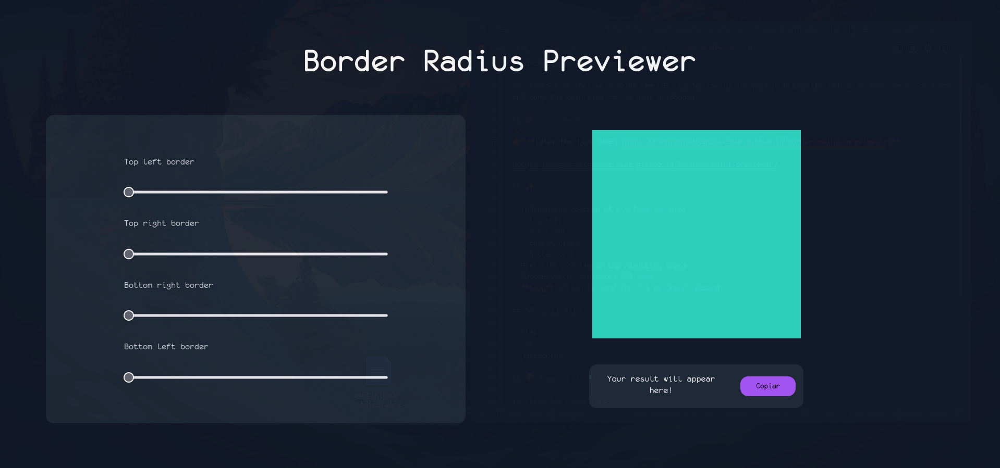
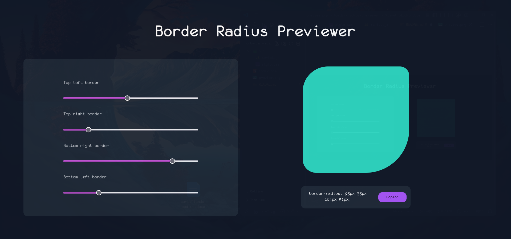

# Border Radius Previewer

An interactive tool to preview the CSS `border-radius` property. Adjust the radius of each corner of a box and copy the resulting CSS to your clipboard.




## 🚀 Live Demo

👉 **[View the live demo](https://medgabrielgarcia-star.github.io/border-radius-previewer/)**

https://medgabrielgarcia-star.github.io/border-radius-previewer/

## ✨ Features

- Independent control of all four corners:
  - Top left
  - Top right
  - Bottom right
  - Bottom left
- Real-time preview of the resulting shape.
- Automatically generated CSS code.
- **Copy** button to send the CSS to the clipboard.

## 🛠️ Built With

- HTML
- CSS
- JavaScript

## 📦 Running Locally

1. Clone the repository:

   ```bash
   git clone https://github.com/medgabrielgarcia-star/border-radius-previewer.git
   ```

2. Move into the project folder:

   ```bash
   cd border-radius-previewer
   ```

3. Open `index.html` in your browser.

## 📖 How to Use

1. Enter a value for each corner in the corresponding fields.
2. Watch the preview box update as you change the values.
3. Click **Copy** to copy the generated `border-radius` rule.

## 💡 Credits

This project is based on the **Border-radius Previewer** idea (Tier: 1-Beginner) from the [App Ideas Collection](https://github.com/florinpop17/app-ideas) by [Florin Pop](https://github.com/florinpop17).

- Original project description: [Border-Radius-Previewer.md](https://github.com/florinpop17/app-ideas/blob/master/Projects/1-Beginner/Border-Radius-Previewer.md)

## 📄 License

This project is available for educational and personal use.

---
Status: Completed ✅

Author: Gabriel García